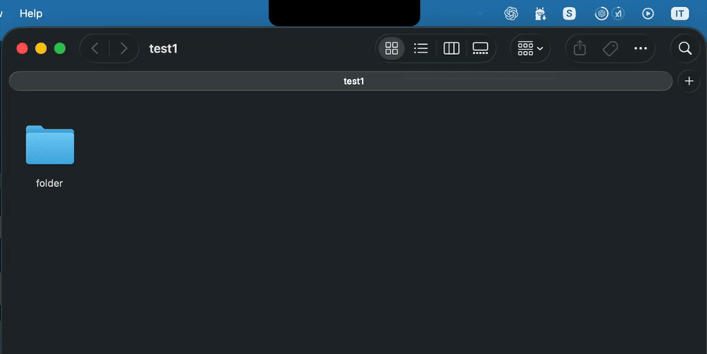

# Centik

A minimalist, native macOS file shelf anchored to the MacBook notch.

Drag files, folders, links, or text toward the notch to tuck them away, then drag them right back out wherever you need them. On Macs without a notch or on external displays, Centik adapts cleanly into a top-center pill (or an invisible top-edge trigger).



## Features

- **Real Move-to-Shelf (or Bookmark Mode)** — Drop files from your Desktop or Finder and they move straight into Centik. Drag them out to move them to your destination, or press **×** / **Clear** to return them right back to their original folder. Prefer leaving originals in place? Switch to Bookmark mode in Settings.
- **Multi-Select & Drag All** — Select multiple items (`⌘`-click, `⇧`-click, `⌘A`) or grab the **Drag All** handle to drop everything at once.
- **Files, Folders, Links & Text** — Accepts files, folders, promised files (Safari, Photos, Mail), web links (`.webloc`), and text snippets (`.txt`).
- **Quick Look, Share & Zip** — Press `Space` for native Quick Look previews, compress items into a `.zip` in one click, or right-click to AirDrop/Share and copy files or paths.
- **Customizable Global Shortcut** — Toggle the shelf from anywhere (`⌥V` by default, customizable in Settings without Accessibility permissions).
- **Notch, Non-Notch & Multi-Display Ready** — Snaps to the hardware notch, follows your cursor across external monitors if enabled, and stays out of your Dock.

## Requirements

- macOS 14.0+ (Sonoma or later)
- Xcode 16+ (to build from source)

## Build & Run

### Command Line

```bash
./scripts/build.sh
open build/Build/Products/Debug/Centik.app
```

### Xcode

1. Open `Centik.xcodeproj`.
2. Wait for Swift Package Manager to resolve dependencies (`DynamicNotchKit`, `Pow`, `Lottie`).
3. Select the **Centik** scheme and press **Run**.

### Release DMG (Universal: Apple Silicon + Intel)

```bash
./scripts/release.sh
```

This outputs `dist/Centik.dmg`. To sign and notarize with an Apple Developer ID, set `SIGN_IDENTITY` and `NOTARY_PROFILE` (see comments in `scripts/release.sh`).

## Project Structure

```text
Centik/
├── App/        # Entry point, single-instance guard, composition root
├── Menu/       # Menu bar extra
├── Panel/      # Notch geometry, hover/drag sensor, pass-through window
├── Shelf/      # Store, move/return persistence, Quick Look thumbnails
├── Support/    # Preferences, Carbon global hotkey, Quick Look, haptics, login item
└── Views/      # Shelf chrome, item cards, native multi-file drag source, settings
```

## Credits

Built with SwiftUI and AppKit, using:
- [DynamicNotchKit](https://github.com/MrKai77/DynamicNotchKit)
- [Pow](https://github.com/EmergeTools/Pow)
- [Lottie](https://github.com/airbnb/lottie-spm)

## License

Centik is licensed under the [GNU General Public License v3.0](LICENSE).
